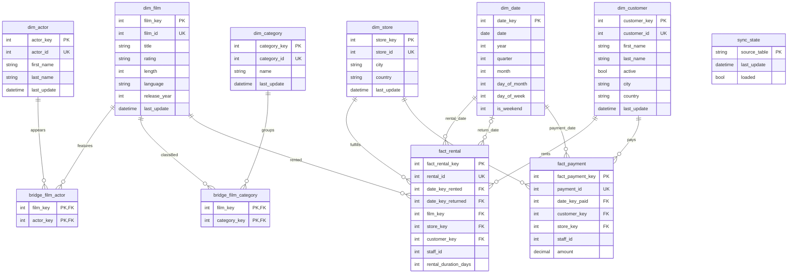

# Sakila Analytics Sync

This project uses SQLAlchemy to copy reporting data from MySQL Sakila into a SQLite file. The target has six dimensions, two bridges, two fact tables, and a table that tracks the last source update processed for each table.

## Setup

The implementation uses Python 3.12 and was tested with Python 3.12.5, SQLAlchemy 2.0.44, PyMySQL 1.1.2, pytest 8.4.2, MySQL 8.0.46, and SQLite 3.46.1. Use a MySQL 8.0 server with the [official Sakila sample database](https://dev.mysql.com/doc/sakila/en/sakila-installation.html) installed.

Run from the directory containing this README:

```bash
python3.12 -m venv .venv
source .venv/bin/activate
python -m pip install -r requirements.txt
```

| Environment variable | Purpose |
| --- | --- |
| `SAKILA_USER` | Required MySQL account. The four sync commands need read access to Sakila. |
| `SAKILA_PASSWORD` | MySQL password, if required. Set it in your shell environment. |
| `SAKILA_HOST` | MySQL host. Defaults to `127.0.0.1`. |
| `SAKILA_PORT` | MySQL port. Defaults to `3306`. |
| `SAKILA_SOCKET` | Optional local Unix socket path. When set, PyMySQL uses the socket. |
| `SAKILA_DATABASE` | Source database name. Defaults to `sakila`. |
| `ANALYTICS_DB` | Path to a writable SQLite file. Defaults to `analytics.sqlite`. |
| `SAKILA_TEST_DATABASE` | Separate schema for automated tests. Defaults to `sakila_test` and must end in `_test`. |

## Commands

```bash
python -m sakila_sync init
python -m sakila_sync full-load
python -m sakila_sync incremental
python -m sakila_sync validate
python -m sakila_sync validate --from 2005-07-01 --to 2005-07-31
```

`init` verifies the source connection, creates SQLite tables and indexes, and fills `dim_date` and the initial `sync_state` rows. Run `full-load` before the first `incremental`. Both sync commands write dimensions, bridges, and facts in order, validate the results, and commit the data and markers together. A failure rolls back the run. Repeating the full load preserves existing surrogate keys.

Incremental change detection reads the source IDs whose `last_update` is at or after the saved marker. Rows with a NULL timestamp are checked on every run. Changes to a country, city, or address also refresh affected customers and stores. A language change refreshes its films. Changes to inventory or a rental refresh dependent facts, and a staff store change refreshes payments without rentals. The inclusive boundary can replay a batch, especially when the sample data shares a single timestamp. Upserts preserve existing keys and prevent duplicate rows.

A rental's store is taken from inventory. A payment uses the rental's inventory store when a rental exists and the payment staff member's store otherwise. Rental duration is the difference between calendar dates. An open rental has a NULL return date key and duration. Source deletions are outside the sync scope. An existing target row whose source was deleted is retained, and a count or key discrepancy is reported by validation.

`validate` checks natural keys, foreign keys, dates, fact counts, and payment totals by store. The money tolerance is one cent per store. Date bounds are inclusive and can be supplied independently. With neither bound specified, the command checks the 30 calendar days ending on the latest source payment date. Date bounds filter the facts by rental or payment date. Dimension coverage and foreign key checks apply across the database. The post-sync audit checks the complete history. Its separate reads of IDs, dates, and totals are part of validation and do not cause unchanged records to be reloaded. Commands log a human-readable result and return exit code 0 on success or 1 on runtime failure. Invalid command arguments return a nonzero exit code.

## Analytics schema



## Indexes

| Table | Indexed columns | Purpose |
| --- | --- | --- |
| `dim_film`, `dim_actor`, `dim_category`, `dim_store`, `dim_customer` | Unique `film_id`, `actor_id`, `category_id`, `store_id`, and `customer_id`, respectively | Enforce one row per Sakila entity and identify the row to overwrite in an upsert. |
| `fact_rental` | Unique `rental_id` | Identifies the same rental after a return and prevents duplicate facts on replay. |
| `fact_payment` | Unique `payment_id` | Identifies the same payment on replay. |
| `fact_rental` | Separate indexes on `date_key_rented`, `date_key_returned`, `film_key`, `store_key`, and `customer_key` | Support date filters and lookups by film, store, and customer. The two date indexes serve separate date roles. |
| `fact_payment` | Separate indexes on `date_key_paid`, `store_key`, and `customer_key` | Support payment date ranges and lookups by store or customer. |
| `bridge_film_actor`, `bridge_film_category` | Composite primary keys on both foreign keys | Uniquely identify each film and actor or film and category pair and support lookup by film. |
| `dim_date`, `sync_state` | Primary keys on `date_key` and `source_table` | Ensure one row per calendar date or tracked source table. |

## Test setup

Install a second copy of official Sakila in a dedicated test schema before running pytest. Starting with fresh official scripts in the current shell, change only their schema selection and load them into the same server. These commands replace the dedicated `sakila_test` schema if it exists.

```bash
sed -E 's/^(DROP SCHEMA IF EXISTS|CREATE SCHEMA|USE) sakila;/\1 sakila_test;/' /path/to/sakila-schema.sql > /tmp/sakila-test-schema.sql
sed -E 's/^USE sakila;/USE sakila_test;/' /path/to/sakila-data.sql > /tmp/sakila-test-data.sql
mysql -h 127.0.0.1 -u YOUR_MYSQL_USER -p < /tmp/sakila-test-schema.sql
mysql -h 127.0.0.1 -u YOUR_MYSQL_USER -p < /tmp/sakila-test-data.sql
python -m pytest -vv -s
```

The account needs read access to the clean fixture and read, insert, update, and delete access to the test copy. Use `SAKILA_DATABASE` for the clean fixture and `SAKILA_TEST_DATABASE` for the test copy. Each test uses a fresh SQLite file. The fixture restores the MySQL rows that these tests change before and after each case using ORM statements. The tests cover initialization, repeat full loads, same-second new rows, updates to rentals and geography, and deliberate count and revenue mismatches.

## Database statements

The application and tests use SQLAlchemy models and statements for data reads, writes, and index creation. The only direct database statements in application code are the SQLite connection `PRAGMA foreign_keys=ON` and the MySQL session `SET time_zone = '+00:00'`. They enable referential integrity and keep timestamp markers in the same time zone across sessions. Both are connection settings outside ORM data operations. The official Oracle scripts are used only to install the source sample databases.
